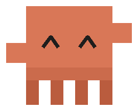
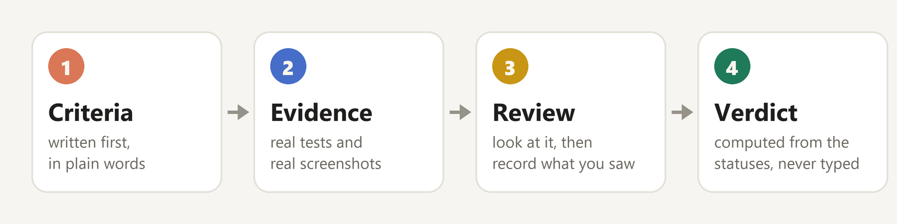
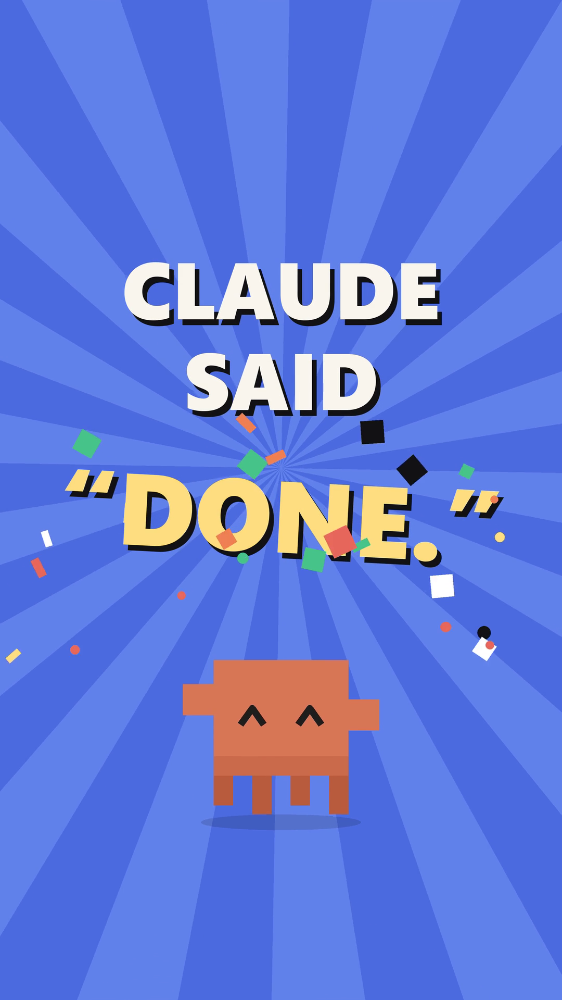
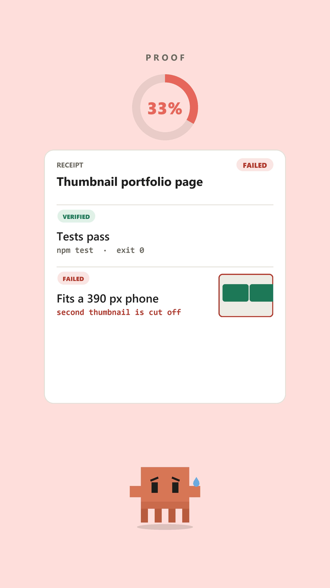
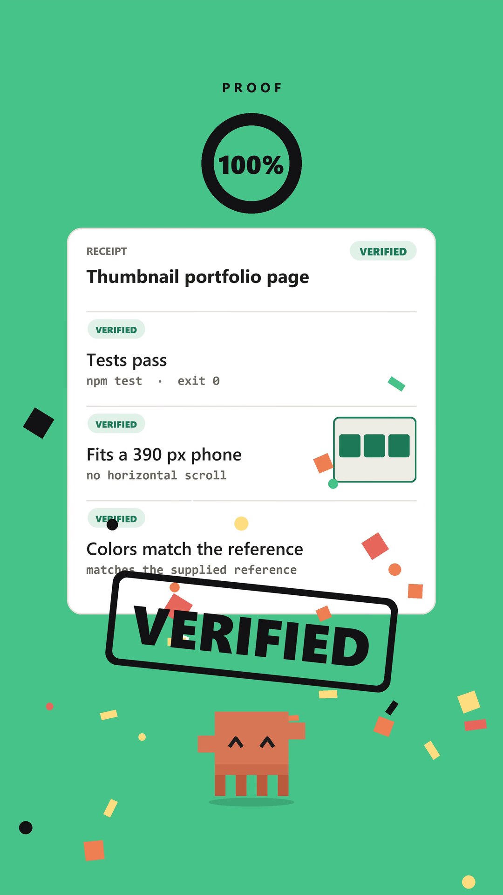
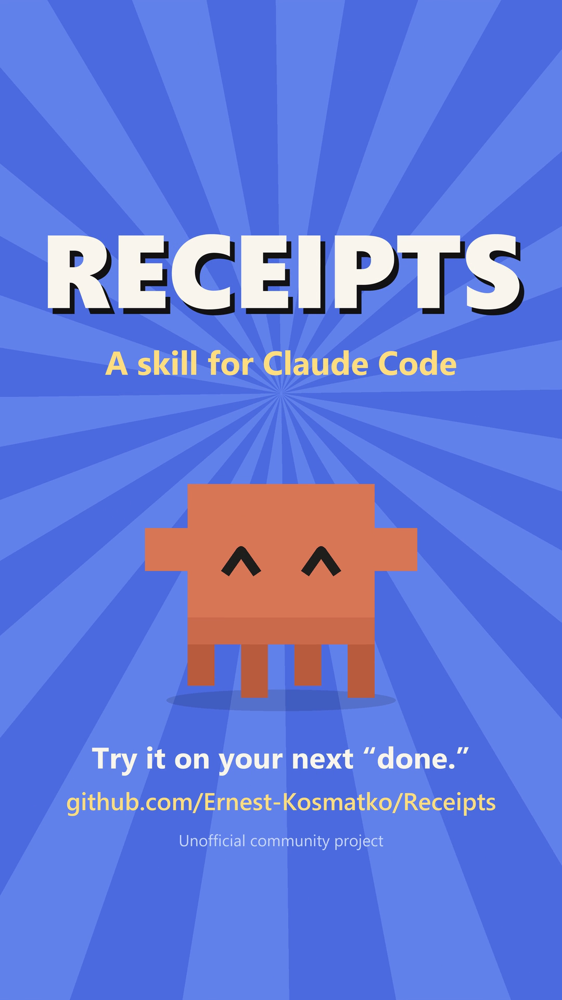

<p align="center">
  
</p>

<h1 align="center">Receipts</h1>

<p align="center">
  A Claude Code skill that makes the agent prove its work before it says "done".<br>
  Real tests, real screenshots, and a verdict computed from the evidence.
</p>

<p align="center">
  
  
  
  
</p>

<p align="center">
  <a href="#install">Install</a> &nbsp;|&nbsp;
  <a href="#usage">Usage</a> &nbsp;|&nbsp;
  <a href="#verdicts">Verdicts</a> &nbsp;|&nbsp;
  <a href="#how-it-works">How it works</a> &nbsp;|&nbsp;
  <a href="#video">Video</a> &nbsp;|&nbsp;
  <a href="#tests">Tests</a>
</p>

> [!NOTE]
> Unofficial community project, not affiliated with Anthropic.

## Why

An AI agent finds it easy to write "done" and hard to be right about it. A layout that overflows on a phone, a test that was never run, a file that was written but never opened: the claim is cheap and checking it falls on you.

Receipts makes the claim cost something. Before the agent can report success it has to say what must be true, run real checks, look at real screenshots, and hand over a one-page receipt. What was not checked is listed on the receipt, in plain sight.

<table align="center">
  <tr>
    <td align="center"></td>
    <td align="center"></td>
  </tr>
  <tr>
    <td align="center"><sub>A receipt filling in as checks pass</sub></td>
    <td align="center"><sub>The receipt for this repository's own release check</sub></td>
  </tr>
</table>

## How it works at a glance

<p align="center">
  
</p>

## Features

| | |
|---|---|
| **Criteria first** | The agent states what has to be true before it checks anything, so "looks fine" cannot count as proof |
| **Recorded commands** | `run` keeps the command, exit code, duration and the tail of the output. Tokens and passwords are redacted |
| **Real screenshots** | `shot` uses headless Chrome, Edge or Chromium at true viewport widths, including phone widths |
| **Honest notes** | A criterion can only be marked verified together with a note saying what was actually observed |
| **Derived verdict** | FAILED, PARTIAL or VERIFIED, worked out from the statuses and never typed by hand |
| **One file** | A self-contained HTML receipt with embedded screenshots and a light and a dark theme |
| **Easy install** | Two plugin commands, or one prompt that makes Claude install it for you |
| **Stop hook** | Optional. Blocks a "done" when files were edited and no receipt was produced |
| **No dependencies** | Standard library only |

## Install

### With Claude Code

Add the marketplace once, then install the plugin:

```bash
claude plugin marketplace add Ernest-Kosmatko/Receipts
```

```bash
claude plugin install receipts@ernest-kosmatko
```

Inside a session the same two steps are `/plugin marketplace add Ernest-Kosmatko/Receipts` and `/plugin install receipts@ernest-kosmatko`. Claude then uses the skill on its own, and you can also run it as `/receipts:receipts`.

### Ask Claude to install it

Paste this into Claude Code and it does the rest:

```text
Install the Receipts skill from https://github.com/Ernest-Kosmatko/Receipts by following docs/install-with-claude.md
```

The steps Claude follows are in [docs/install-with-claude.md](docs/install-with-claude.md). It asks you before it touches `settings.json`.

### Manual

```bash
git clone https://github.com/Ernest-Kosmatko/Receipts.git
cd Receipts
python install.py            # copies the skill to ~/.claude/skills/receipts
```

The Stop hook is optional and separate, because it edits `settings.json`. Add it with `python install.py --hook` (skill and hook) or `python install.py --hook-only` (hook only, if you installed the plugin). The installer backs up `settings.json` first. Remove everything with `python install.py --uninstall`.

Start a new Claude Code session after installing, so the skill is loaded.

## Usage

Claude picks the skill up on its own when it is about to report that work is finished. The same commands work by hand. `R` points at wherever the skill lives, which is `~/.claude/skills/receipts` after a manual install:

```bash
R="python ~/.claude/skills/receipts/scripts/receipt.py"

$R init --task "Fix the pricing page" --criteria "Tests pass" "No horizontal scroll at 390 px"
$R run --cmd "npm test" --criterion 1
$R shot --target index.html --widths 390,1280 --criterion 2
# open the screenshots and look at them, then record what you saw
$R mark --criterion 2 --status verified --note "one column, no horizontal scroll"
$R unverified "Not tried on a real phone"
$R render --open
$R check
```

| Command | What it does |
|---|---|
| `init` | Opens a receipt with a task and its criteria |
| `run` | Runs a command through the shell and records it. With `--criterion`, exit 0 verifies and anything else fails the criterion |
| `shot` | Screenshots a file or URL at the given widths. A screenshot alone proves nothing, so the criterion stays pending |
| `attach` | Adds an image taken by another tool |
| `mark` | Sets a criterion to verified, failed or unverified. Verified needs `--note` |
| `unverified` | Adds a line to the "Not verified" list |
| `render` | Writes the HTML receipt next to the ledger. `--open` shows it, `--no-changes` leaves out the git summary |
| `check` | Prints the verdict, lists open criteria, exits 0 only for VERIFIED |

Receipts are stored in `.receipts/` in the current directory. Use `--dir` or `RECEIPTS_DIR` to put them elsewhere.

## Verdicts

The verdict is a function of the criteria statuses. It cannot be talked up.

| Verdict | When |
|---|---|
|  | At least one criterion failed |
|  | Nothing failed, but some criterion is still pending or unverified |
|  | Every criterion is verified |

## How it works

Every receipt is a JSON ledger: the task, the criteria with a status each, and the evidence. Commands, screenshots and notes are added to it, and `render` turns it into the HTML card.

**Phone-width screenshots.** Headless Chrome and Edge never lay a page out narrower than about 500 px, so a screenshot "at 390 px" would really be a 500 px layout cropped to 390. For widths below 500 the page is loaded in an iframe of the exact width instead, which gives it a true 390 px viewport, media queries included. If Pillow is installed the result is cropped to the requested width.

**The Stop hook.** It reads the session transcript when Claude tries to finish a turn. It blocks once if files were edited, the last message claims completion, and no `receipt.py` command ran after the last edit. Words inside quotes, code spans and blockquotes are not treated as a claim. It never blocks twice in a row, and `RECEIPTS_GATE=off` turns it off.

## Video

A 35 second walkthrough is in [docs/media/receipts-reel.mp4](docs/media/receipts-reel.mp4).

<table align="center">
  <tr>
    <td align="center"></td>
    <td align="center"></td>
    <td align="center"></td>
    <td align="center"></td>
  </tr>
  <tr>
    <td align="center"><sub>It says done</sub></td>
    <td align="center"><sub>A check fails</sub></td>
    <td align="center"><sub>Proved again</sub></td>
    <td align="center"><sub>Your turn</sub></td>
  </tr>
</table>

## Tests

```bash
pip install pytest
pytest
```

The tests run the command line in temporary directories. They need no network and no browser. One of them keeps the repository itself plain: no emoji, no long dashes, no tool attribution.

## Limitations

- Screenshots show the first screen only and cannot log in or click. For interactive flows take the screenshot with another tool and use `attach`
- `run` executes commands through the shell, so only record commands you would type yourself
- The hook recognises completion words in English and Polish. Other phrasing slips through
- A receipt shows what was checked, not whether the checks were good. The criteria decide that
- `shot` needs Chrome, Edge or Chromium. Everything else works without a browser
- The plugin route needs a Claude Code version with plugin support. The plugin does not include the Stop hook, use `install.py --hook-only` for that

## License

MIT, see [LICENSE](LICENSE).
