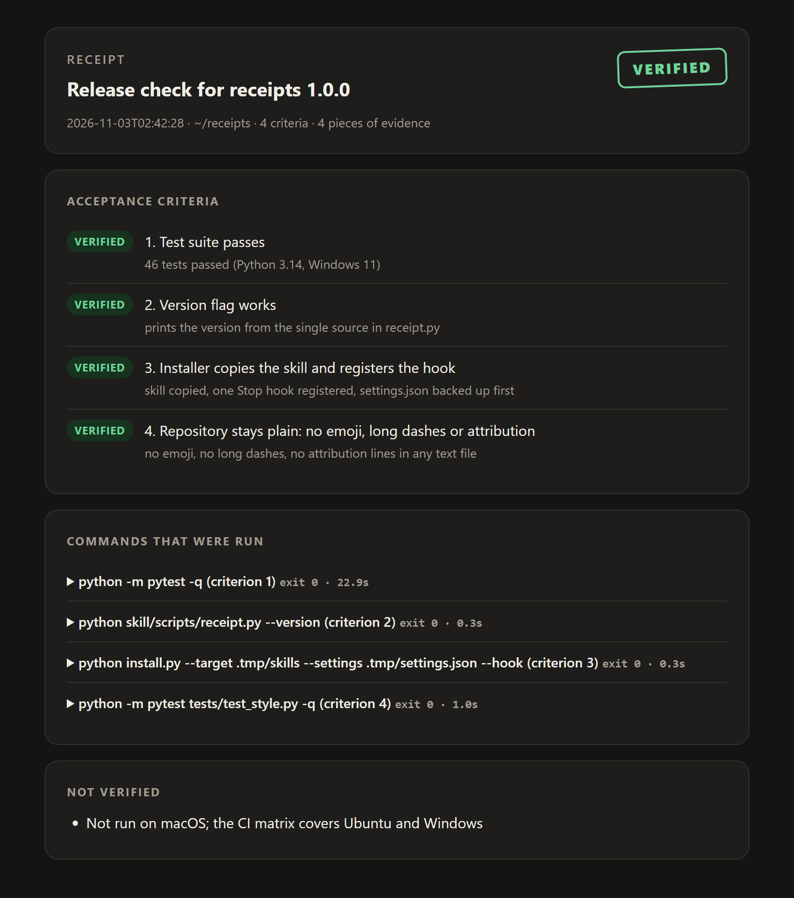
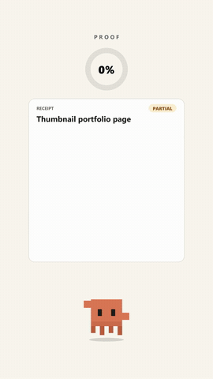

# receipts


A Claude Code skill that makes the agent prove its work before it says "done". It writes acceptance criteria first, runs real checks, looks at real screenshots, and hands over a one-page receipt whose verdict is computed from the evidence.

> Unofficial community project, not affiliated with Anthropic.



## Features

- Acceptance criteria are written before the work is checked, so "looks fine" cannot count as proof
- `run` records the command, exit code, duration and the tail of the output, with tokens and passwords redacted
- `shot` takes headless Chrome, Edge or Chromium screenshots at real viewport widths, including phone widths
- A criterion can only be marked verified with a note that says what was actually observed
- The verdict is derived, never typed: FAILED, PARTIAL or VERIFIED
- One self-contained HTML receipt with embedded screenshots, light and dark theme
- Optional Stop hook that blocks a "done" when files were edited and no receipt was produced
- Standard library only

## Install

```bash
git clone https://github.com/Ernest-Kosmatko/Receipts.git
cd Receipts
python install.py            # copies the skill to ~/.claude/skills/receipts
python install.py --hook     # also registers the Stop hook, after backing up settings.json
```

Start a new Claude Code session to load the skill. Remove everything with `python install.py --uninstall`.

## Usage

Claude picks the skill up on its own when it is about to report that work is finished. The same commands work by hand:

```bash
R="python ~/.claude/skills/receipts/scripts/receipt.py"

$R init --task "Fix the pricing page" --criteria "Tests pass" "No horizontal scroll at 390 px"
$R run --cmd "npm test" --criterion 1
$R shot --target index.html --widths 390,1280 --criterion 2
# open the screenshots and look at them, then record what you saw
$R mark --criterion 2 --status verified --note "one column, no horizontal scroll"
$R unverified "Not tried on a real phone"
$R render --open
$R check
```

| Command | What it does |
|---|---|
| `init` | Opens a receipt with a task and its criteria |
| `run` | Runs a command through the shell and records it. With `--criterion`, exit 0 verifies and anything else fails the criterion |
| `shot` | Screenshots a file or URL at the given widths. A screenshot alone proves nothing, the criterion stays pending |
| `attach` | Adds an image taken by another tool |
| `mark` | Sets a criterion to verified, failed or unverified. Verified needs `--note` |
| `unverified` | Adds a line to the "Not verified" list |
| `render` | Writes the HTML receipt next to the ledger |
| `check` | Prints the verdict, lists open criteria, exits 0 only for VERIFIED |

Receipts are stored in `.receipts/` in the current directory. Use `--dir` or `RECEIPTS_DIR` to put them elsewhere.

## Video



A 35 second walkthrough is in [docs/media/receipts-reel.mp4](docs/media/receipts-reel.mp4).

## How it works

Every receipt is a JSON ledger: the task, the criteria with a status each, and the evidence. The verdict is a function of the statuses:

| Verdict | When |
|---|---|
| FAILED | any criterion failed |
| PARTIAL | no failures, but some criterion is pending or unverified |
| VERIFIED | every criterion is verified |

Headless Chrome and Edge never lay a page out narrower than about 500 px, so a screenshot at 390 px would really be a 500 px layout cropped. For widths below 500 the page is loaded in an iframe of the exact width instead, which gives it a true 390 px viewport, media queries included. If Pillow is installed the result is cropped to the requested width.

The Stop hook reads the session transcript when Claude tries to finish a turn. It blocks once if files were edited, the last message claims completion, and no `receipt.py` command ran after the last edit. Words inside quotes, code spans and blockquotes are not treated as a claim. It never blocks twice in a row, and `RECEIPTS_GATE=off` turns it off.

## Tests

```bash
pip install pytest
pytest
```

The tests run the command line in temporary directories. They need no network and no browser.

## Limitations

- Screenshots show the first screen only and cannot log in or click. For interactive flows take the screenshot with another tool and use `attach`
- `run` executes commands through the shell, so only record commands you would type yourself
- The hook recognises completion words in English and Polish. Other phrasing slips through
- A receipt shows what was checked, not whether the checks were good. The criteria decide that
- `shot` needs Chrome, Edge or Chromium. Everything else works without a browser

## License

MIT
